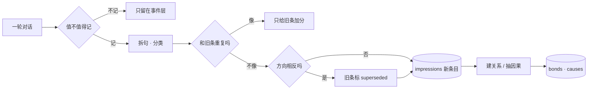

# dsh-brain

**给 AI 一份会想起来、也会自己收着用的长期记忆。**

不是把聊天记录截一段塞回上下文，而是真地记：先判断这句话值不值得记、属于哪一类、和已有的事重不重复、冲不冲突，再决定写不写、怎么连；要用的时候按语义找回来，挑最相关的几条注入。

纯 Node 实现，记忆全在一个 SQLite 文件里，不依赖外部数据库、向量服务或任何模型接口。


<sub>内置的 3D 星图（记忆漩涡视图）：每个点是一条记忆，每条线是一条关系；记忆按新旧沿螺旋臂铺开，整片悬在深空星云里。</sub>

---

## 目录

- [它解决什么问题](#它解决什么问题)
- [一条记忆的一生](#一条记忆的一生)
- [核心特性](#核心特性)
- [快速开始](#快速开始)
- [模型能用的工具](#模型能用的工具)
- [配置](#配置)
- [记忆健康](#记忆健康)
- [数据与隐私](#数据与隐私)
- [目录结构](#目录结构)
- [设计取舍](#设计取舍)
- [常见问题](#常见问题)

---

## 它解决什么问题

大多数「AI 记忆」的做法是把最近几轮对话截一段塞回去。这有三个毛病：

| 毛病 | 表现 |
| --- | --- |
| **记不住重要的** | 三周前定下的规矩，和昨天随口一句闲话，进上下文的机会一样 |
| **记太多废话** | 「好的」「我看看」这种过程性对话也被当成记忆 |
| **记了但找不回来** | 换个说法问同一件事，就召回不到了 |

dsh-brain 换了个思路：把记忆当成一个**有结构的库** —— 写入前先筛，写入时建关系，读取时按结构打分。

一句话总结：**宁可漏，不可滥。**

## 一条记忆的一生



要用的时候，反方向走一遍：


## 核心特性

### 写入：三道闸，宁可漏不可滥

- **过程话不进库**：寒暄、确认、过程性叙述只留在事件层，不变成记忆。
- **没新增不新建**：和已有条目高度相似时，只给旧条加分，不产出重复记忆。
- **分不出类别不记**：事实、偏好、教训、方法、承诺五类之外，宁可不记。
- **质量闸**：少于 6 字、纯符号、同一个字重复的，直接拒掉。

> 为什么要这么严：记忆库一旦进了沙子，它不是「多一条」的问题，而是**每一条检索结果的可信度都在下降**。清理污染的成本远高于当初拒掉它的成本。

### 关系：记忆不是孤立的条目

每条记忆写进来的同时会连边：

| 关系 | 含义 | 怎么产生 |
| --- | --- | --- |
| **同在** | 同一个场景里发生的两件事 | 写入时同场景 |
| **重复** | 同一件事被讲过多次 | 相似度合并，权重累加（有上限） |
| **因果** | 一条真的导致了另一条 | 「因为/所以」抽取 + 模型判断 |

因果边有三道校验：**证据不能是两端自己**、**果不能早于因**（倒挂的自动降级为 suspect）、**不能成环**。

> 因果是这张图里最贵的信息，也是最容易造假的信息。所以每条边都必须带证据，宁可少几条，不能多几条假的。

### 覆盖：新说法盖掉旧说法，链路不断

同一条事实有了新版本（比如换了端口号），旧条目会被标成 `superseded` 而不是删除；它身上的关系和因果边会自动**转接到新条目**上。

规矩类记忆另外判方向：一边「要」一边「不要」、共享足够多实词时，新规矩会**自动把旧规矩置为 `superseded`**，并在 `gist` 里记下「被谁取代」—— 注入不再取旧条，但库里还查得到。

### 检索：点火 + 一跳扩散 + 重排

1. **点火**：按关键词稀有度加权，叠加向量相似度找候选。
2. **扩散**：沿关系网走**一跳**把邻居拉进来（走两跳会串味）。
3. **重排**：综合新鲜度（半衰期 7 天）、确信度、权重、被用过几次、项目匹配、等级（`sunk` / `blur` 真的掉分）。

阈值是 0.35。**带出来 0 条也是正常结果，不许硬凑。**

> 半衰期为什么是 7 天不是 30 天：试过 30 天，老记忆一上来就把正确答案挤掉，基准题 @3 从 100% 掉到 85%。这个数是有测试撑着的。

### 注入：每轮自动带三块

| 块 | 内容 |
| --- | --- |
| **现在** | 当前时间、距上一句对话多久、手上在弄什么 |
| **我记得** | 这一轮该想起的那几条（带确信度语气） |
| **说话风格** | 你的表达偏好 |

不确定的记忆会带保留语气（「我记得好像是……」），不会当成事实塞进上下文。

### 可视化

配套一个只读控制台和 3D 星图：支持**记忆漩涡 / 土星环 / 记忆球**三种布局，点开任一节点能看到全文、全部连线和因果。页面本身不进这个包（它依赖本地 vendor 的 three.js），仓库里只放截图。

## 快速开始

```bash
dsh plugin --profile desktop add github:mmrgoodt/dsh-brain
```

装完重启 DSH。第一次启动会在数据目录里自动建库，不需要额外配置。

装好后你什么都不用做，它会自己开始工作：说话时挑值得记的记下，回答前把相关的几条带回来。

## 模型能用的工具

| 工具 | 作用 |
| --- | --- |
| `brain_remember` | 记一件事（类型自己选：事实/偏好/教训/方法/承诺） |
| `brain_recall` | 按语义找记忆 |
| `brain_forget` | 删掉一条记错的（真删，不留副本） |
| `brain_rename` | 给自己改名 |
| `brain_next` | 拿一份现状材料：每个项目停在哪、有哪些没兑现的话 |
| `brain_cause` | 记一条因果关系（必须带证据） |
| `brain_why` | 顺因果图追问：为什么 / 导致了什么 |
| `brain_health` | 体检：过期状态、可疑因果、建议先清哪个 |

## 配置

`cordis.patch.yml` 的 `config` 段：

| 键 | 默认 | 说明 |
| --- | --- | --- |
| `dataDir` | `~/.dsh/brain` | 记忆库放哪；也可用 `BRAIN_DIR` 覆盖 |
| `enabled` | `true` | 总开关 |
| `inject` | `true` | 是否每轮注入 |
| `console` | `false` | 只读控制台；需要自己起服务脚本 |

## 记忆健康

记忆库会自己长，也会自己烂。dsh-brain 用三种机制兜住：

- **保质期**：状态类事实（「尚未配置」「还没部署」这种）写库时带 **7 天** `expires`。到期后不再参与注入，但库里留着能翻查 —— 状态变了不该再被当成此刻的事实。
- **覆盖**：方向相反的新规矩自动把旧条置 `superseded`，`gist` 记下取代者，可追溯。
- **体检**：`brain_health` 一条命令看全库：多少条、多少过期、多少可疑因果，以及先清哪个。

## 数据与隐私

- 所有记忆在 `brain.db` 一个 SQLite 文件里（外加 WAL），**拷走即备份**。
- 这个仓库**只有代码，不含任何人的记忆数据**。
- 记忆是私人的：库里的内容来自你和模型的对话，别把 `brain.db` 提交到公开仓库。

## 目录结构

| 文件 | 职责 |
| --- | --- |
| `index.js` | 插件入口：注册工具、挂注入钩子、起控制台 |
| `write.js` | 写入侧：判断值不值得记、拆句、建关系、冲突覆盖 |
| `recall.js` | 检索侧：点火、扩散、重排、诊断 |
| `inject.js` | 注入侧：现在 / 我记得 / 说话风格 |
| `cause.js` | 因果：加边、校验、成环检测 |
| `cause-extract.js` · `cause-model.js` | 因果抽取（规则一路 + 模型一路） |
| `think.js` | 后台思考：矛盾、复发、承诺未办、停滞等信号 |
| `consolidate.js` | 合并相似记忆 |
| `digest.js` | 分层摘要 |
| `embed.js` | 向量化 |
| `db.js` | SQLite 封装、表结构、迁移 |
| `db-store.js` | 工具写入的适配层（统一走主写入管线） |
| `text.js` | 分词、相似度、分类、项目推断 |
| `tools.js` | 暴露给模型的工具 |
| `client.js` | 前端注入 |

## 设计取舍

**为什么不用纯向量库？**
纯向量检索回答不了两个问题：「哪条更重要」「哪条已经过时了」。dsh-brain 用关系、使用次数、等级和覆盖关系来回答这两个。

**为什么宁可漏也不滥？**
进库的成本低，纠错的成本高。一条错记忆会污染后面所有依赖它的推理。

**为什么因果要单开一张表？**
因果是单向的、带证据、要查环、要能降级。塞进普通关系里，这些都没法做。

**为什么后台任务要慢慢跑？**
因果挖掘一次只判 2 对、间隔 2 秒，单次最多 300 批。跑快了既烧钱又容易误判；判过的对会留痕，下次跳过，所以慢是安全的。

## 常见问题

**记忆会不会越存越多、把上下文撑爆？**
不会。注入有预算，每轮只放最相关的一小批；库里也有活跃容量上限，超了按使用频率和关系数淘汰。

**改了插件代码要怎么生效？**
热重载通常检测不到这类改动，需要重启 DSH。

**改代码要注意什么？**
改召回参数（阈值、半衰期、权重）前，先在手头的库上跑几道常用的基准题，确认召回没退化；改 `db.js` 的 schema 要升 `SCHEMA_VERSION` 并写迁移。仓库目前没有自带测试，验证靠真实库。

**这台机器和仓库版有什么区别？**
`lib/text.js` 的 `PROJECT_HINTS` 是通用示例，`index.js` 的控制台脚本路径默认留空 —— 这两处按你自己的项目填。

## 许可

[MIT](LICENSE)
